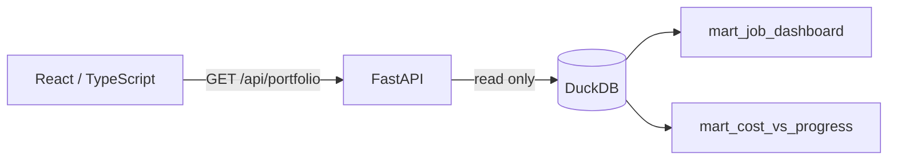

# Dashboard architecture

The dashboard is designed as an operating tool for portfolio and project teams,
not as one chart per assessment question. The presentation can state the case
study conclusions while this application supplies interactive evidence and a
repeatable investigation workflow.

## Current application slice

The portfolio overview provides:

- global division, contract type, project manager, and cost/progress filters;
- cost budget, projected final cost, projected variance, correspondence
  exposure, and attention-count KPIs;
- base, confirmed-adjusted, and downside scenario comparison;
- cost burn versus reported progress, with bubble size representing projected
  variance;
- a job-level cost-risk Pareto with cumulative concentration;
- a ranked job action queue linked to the risk matrix; and
- a visible warning that margin uses a provisional contract-value proxy.

The visual system follows the supplied concept: deep navy navigation, warm
off-white canvas, rounded white cards, restrained blue, and electric lime for
focus and status. All displayed numbers come from the governed marts rather
than frontend calculations, except chart coordinates and the Pareto cumulative
display.

## Request flow

`pipeline/api/repository.py` contains parameterized filtering and response
assembly. `pipeline/api/schemas.py` defines the Pydantic response contract. The
frontend mirrors that contract in `app/src/types.ts`, so API and display fields
remain explicit.

## Endpoints

| Endpoint | Purpose |
|---|---|
| `GET /api/health` | Local service health check |
| `GET /api/portfolio` | Complete portfolio overview response |

`/api/portfolio` accepts optional `division`, `contract_type`,
`project_manager_id`, and `progress_status` query parameters. It returns filter
options, KPIs, scenarios, status counts, ranked jobs, and Pareto points in one
request to keep the first page responsive and internally consistent.

## Next application slice

The next page should turn a selected job into a drill-down route. It will use
the existing job, cost-code, monthly cost, subcontractor, and correspondence
event marts to explain why the job is at risk without changing the portfolio
business rules. Equipment and cross-division views can follow as independent
tabs.
