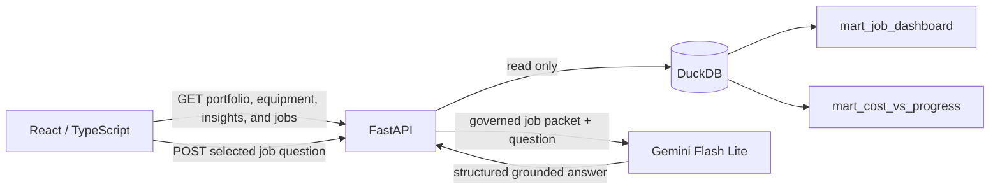

# Dashboard architecture

The dashboard is designed as an operating tool for portfolio and project teams,
not as one chart per assessment question. The presentation can state the case
study conclusions while this application supplies interactive evidence and a
repeatable investigation workflow.

## Current application slice

The portfolio overview provides:

- global division, contract type, project manager, and cost/progress filters;
- cost budget, projected final cost, projected variance, correspondence
  exposure, and attention-count KPIs;
- base, confirmed-adjusted, and downside scenario comparison;
- cost burn versus reported progress, with bubble size representing projected
  variance;
- a budget-outlook split distinguishing jobs already over budget, jobs forecast
  to cross the budget, jobs remaining within forecast, and missing budgets;
- a job-level cost-risk Pareto with cumulative concentration;
- a ranked job action queue linked to the risk matrix; and
- a visible warning that margin uses a provisional contract-value proxy.

Selecting a job opens a dedicated `#/jobs/{job_id}` drill-down with:

- job financial KPIs and base, confirmed-adjusted, and downside scenarios;
- monthly adjusted actual, forecast, and cumulative cost trends;
- a current-versus-forecast cost position against the current budget;
- budget versus projected cost by cost code and a complete cost-code table;
- categorized correspondence exposure and event-level evidence;
- reported schedule exposure and highest-attention schedule activities; and
- ledger and correspondence exposure by subcontractor; and
- a single-turn, selected-job Gemini answer grounded in the same governed job
  packet, including equipment assignments and labeled supporting facts.

The `#/insights` tab turns the assessment questions into seven presentation-ready
business themes:

- financial outlook by scenario and division;
- adverse cost-variance concentration and the jobs that drive it;
- cost burn versus reported progress;
- owned-versus-rented equipment economics by division;
- shared cost-code and subcontractor exposure;
- correspondence-derived commercial and schedule risk; and
- source-quality exceptions plus end-to-end reconciliation status.

Each conclusion is paired with supporting metrics and, where relevant, links
back to the job-detail evidence.

The `#/data-flow` page presents the solution architecture as a blueprint-style
flow. It separates deterministic project-data modeling from schema-constrained
correspondence extraction, then shows both paths converging into governed
DuckDB marts, a read-only API, and the operating and supporting dashboard views.

The `#/equipment` operating page provides division, ownership, equipment-type,
and job filters; owned-versus-rented unit economics; utilization versus unit
cost; type-level comparison; and assignment-level drill-through to job detail.
It explicitly describes cost efficiency rather than profitability because the
source does not include the monetary value of production.

The visual system follows the supplied concept: deep navy navigation, warm
off-white canvas, rounded white cards, restrained blue, and electric lime for
focus and status. All displayed numbers come from the governed marts rather
than frontend calculations, except chart coordinates and the Pareto cumulative
display.

## Request flow

`pipeline/api/repository.py` contains parameterized filtering and response
assembly. `pipeline/api/schemas.py` defines the Pydantic response contract. The
frontend mirrors that contract in `app/src/types.ts`, so API and display fields
remain explicit.

For repeatable operations, `flint refresh` runs ingestion, transformation, base
modeling, cache-aware correspondence extraction, governed correspondence
modeling, and final analysis in dependency order. The command reuses cached
extractions for unchanged documents and stops when a stage or reconciliation
gate fails. In production, a scheduler would invoke this command or the same
stage functions and publish a versioned snapshot only after the full run passes.

## Endpoints

| Endpoint | Purpose |
|---|---|
| `GET /api/health` | Local service health check |
| `GET /api/portfolio` | Complete portfolio overview response |
| `GET /api/jobs/{job_id}` | Complete financial, delivery, and correspondence job packet |
| `POST /api/jobs/{job_id}/ask` | Single-turn Gemini explanation grounded in the selected job packet |
| `GET /api/equipment` | Filterable equipment cost, utilization, and unit-efficiency analysis |
| `GET /api/insights` | Portfolio assessment evidence across all seven business themes |

`/api/portfolio` accepts optional `division`, `contract_type`,
`project_manager_id`, and `progress_status` query parameters. It returns filter
options, KPIs, scenarios, status counts, ranked jobs, and Pareto points in one
request to keep the first page responsive and internally consistent.

## Next application slice

Refine the current views and presentation wording, using the data-flow page to
explain source lineage, the bounded role of AI, and the controls around the
decision-facing metrics.
