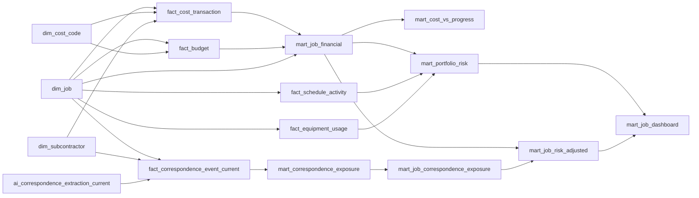

# Analytical data model

The dimensional model separates reusable business entities from events and
dashboard-ready aggregates. It is rebuilt from the typed staging layer with
`uv run flint model` and is included in `uv run flint build`.

## Table grains

| Table | Grain | Key |
|---|---|---|
| `dim_job` | One canonical job, plus an unknown member | `job_key` |
| `dim_cost_code` | One estimating cost code, plus an unmapped member | `cost_code_key` |
| `dim_subcontractor` | One normalized subcontractor, plus an unknown member | `subcontractor_key` |
| `fact_cost_transaction` | One nonduplicate ERP posting | `cost_transaction_key` |
| `fact_budget` | One job and estimating cost-code line | `budget_key` |
| `fact_schedule_activity` | One schedule activity | `schedule_activity_key` |
| `fact_equipment_usage` | One valid equipment assignment row | `equipment_usage_key` |
| `ai_correspondence_extraction_current` | One current extraction per correspondence document | `cache_key` |
| `fact_correspondence_event_current` | One current, cleaned correspondence event | `correspondence_event_key` |

Exact duplicate ledger rows are excluded from the transaction fact, but their
counts and amounts are reconciled explicitly. Missing job identifiers, unknown
jobs, unmapped cost codes, and missing subcontractors are assigned to visible
unknown dimension members. This preserves the affected dollars instead of
dropping them through inner joins.

Historical AI responses remain in `ai_correspondence_extractions` and
`fact_correspondence_event`. Analysis must use the `_current` tables so prompt
iterations cannot duplicate documents or events. Reviewed alias and event-type
corrections retain both the extracted and governed values for auditability.

## Analytical marts

| Mart | Purpose |
|---|---|
| `mart_job_financial` | Job budgets, cost composition, forecast, variance, and margin |
| `mart_cost_vs_progress` | Compares cost consumed with reported physical progress |
| `mart_equipment_economics` | Equipment cost and utilization by division and ownership |
| `mart_subcontractor_exposure` | Vendor concentration across jobs and divisions |
| `mart_cost_code_exposure` | Portfolio cost and budget by canonical cost code |
| `mart_portfolio_risk` | Explainable job-level risk classification and reasons |
| `mart_correspondence_exposure` | Event-level commercial classification and governed scope-to-cost-code mapping |
| `mart_job_correspondence_exposure` | Separate confirmed, pending, potential, variance, and schedule exposure by job |
| `mart_job_risk_adjusted` | Base, confirmed-adjusted, and downside financial scenarios by job |
| `mart_job_dashboard` | Executive job summary with combined risk status and reasons |
| `mart_correspondence_cost_code_exposure` | Correspondence exposure by division and canonical cost code |
| `mart_subcontractor_combined_exposure` | Ledger and correspondence exposure kept distinct by subcontractor |
| `mart_monthly_cost_trend` | Monthly and cumulative ledger cost by job and cost code |

`model_reconciliation` is a build gate, not a dashboard mart. It proves that
job, budget, ledger, schedule, and equipment rows reconcile from their source
population into the model. The ledger check also reconciles dollars after the
explicit duplicate exclusion. A failed check rolls back the entire model build.

`model_correspondence_reconciliation` performs the equivalent post-extraction
build gate for document coverage, event counts, current-version uniqueness,
entity resolution, grounding, and deterministic semantic cleanup.

`model_analysis_reconciliation` is the final build gate. It proves event row and
amount preservation, complete nonblank scope mapping, one scenario row per job,
complete event categorization, and ledger-dollar preservation in the monthly
trend. The scope mapping is governed in
`data/reference/correspondence_scope_cost_code_map.csv`; division-specific
earthwork mappings prevent Building and Civil activity from being conflated.
