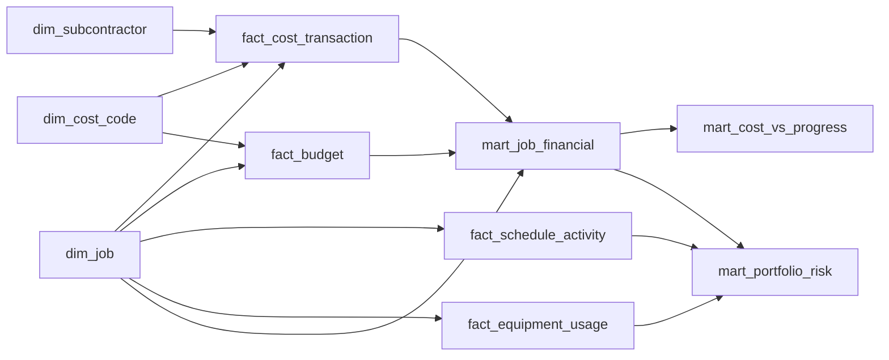

# Analytical data model

The dimensional model separates reusable business entities from events and
dashboard-ready aggregates. It is rebuilt from the typed staging layer with
`uv run flint model` and is included in `uv run flint build`.

## Table grains

| Table | Grain | Key |
|---|---|---|
| `dim_job` | One canonical job, plus an unknown member | `job_key` |
| `dim_cost_code` | One estimating cost code, plus an unmapped member | `cost_code_key` |
| `dim_subcontractor` | One normalized subcontractor, plus an unknown member | `subcontractor_key` |
| `fact_cost_transaction` | One nonduplicate ERP posting | `cost_transaction_key` |
| `fact_budget` | One job and estimating cost-code line | `budget_key` |
| `fact_schedule_activity` | One schedule activity | `schedule_activity_key` |
| `fact_equipment_usage` | One valid equipment assignment row | `equipment_usage_key` |

Exact duplicate ledger rows are excluded from the transaction fact, but their
counts and amounts are reconciled explicitly. Missing job identifiers, unknown
jobs, unmapped cost codes, and missing subcontractors are assigned to visible
unknown dimension members. This preserves the affected dollars instead of
dropping them through inner joins.

## Analytical marts

| Mart | Purpose |
|---|---|
| `mart_job_financial` | Job budgets, cost composition, forecast, variance, and margin |
| `mart_cost_vs_progress` | Compares cost consumed with reported physical progress |
| `mart_equipment_economics` | Equipment cost and utilization by division and ownership |
| `mart_subcontractor_exposure` | Vendor concentration across jobs and divisions |
| `mart_cost_code_exposure` | Portfolio cost and budget by canonical cost code |
| `mart_portfolio_risk` | Explainable job-level risk classification and reasons |

`model_reconciliation` is a build gate, not a dashboard mart. It proves that
job, budget, ledger, schedule, and equipment rows reconcile from their source
population into the model. The ledger check also reconciles dollars after the
explicit duplicate exclusion. A failed check rolls back the entire model build.
